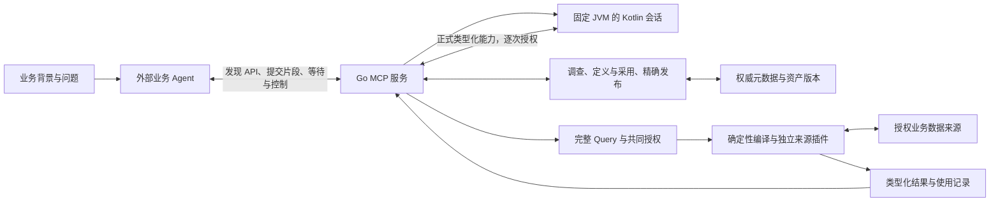

# Agentic OLAP 架构

Agentic OLAP 由可复用语义定义、完整查询语言和确定性计算内核组成。语义管理保存指标、维度、对象来源、关系和共同计算；定义通过精确子引用与槽位组合已有业务含义，形成可继续引用的高层定义。Query 可以直接调用这些定义，也可以针对本次问题组合已有定义、内联计算与有序阶段。定义内部的计算和 Query 组合共用确定性引擎。发布固定语义和授权，查询结构由调用者组织。

产品以统一服务向外部业务 Agent 提供调查、语义资产管理、查询、执行和结果读取。业务项目承载 Agent、业务背景、交互与独立数据接入；Agent 使用服务逐步形成并复用业务定义。Kotlin 内核承载通用计算，Kotlin 上游承载业务空间、采用、发布与授权，Go 负责服务和运行管理。这些是同一产品内部的责任与依赖分层。

[项目文档导航](README.md)

服务由 Go MCP/HTTP 入口、固定 JVM 的 Kotlin 代码会话、唯一持有权威元数据的 Kotlin 应用和有界来源工作进程组成，内部使用 `agentic-olap-runtime/v3` 的具体 Protobuf 消息。代码会话使用 `agentic-olap-kotlin-dsl/v2`；模型对话仍由外部客户端持有。业务后端通过独立 JVM 连接器接入，元数据使用 H2；H2 与 DuckDB 业务后端也走同一插件合同。驱动或协议相同不代表类型、算术、函数、关系保证和一致性相同。Web 工作台与跨数据库联邦计算由各自的独立系统负责。

## 工程边界

| 位置 | 责任 |
| --- | --- |
| `project/` | Go 服务、Kotlin 模块、内部协议、安装入口与开发行为试验 |
| `docs/` | 当前架构、使用导航、来源扩展与安装发行说明 |
| `tools/`、`.github/` | 源码研发维护的固定构建、诊断与 CI 入口，不进入产品能力注册 |
| `examples/` | 使用自含业务数据调用正式接口的人工确定性用法，不表示模型自主成绩 |

研发试验由 Go CLI 明确启动，使用 `examples/` 中的自含数据、作者程序和独立预期，通过正式 MCP 调用同轮服务。部署配置和运行输入通过明确路径交接。

产品业务运行、外部业务压力与源码研发分别承担独立责任。产品 Agent 在既有能力中调查数据、创建或修订语义资产和指标、激活发布、构造查询、执行并解释结果；新增业务指标、调整口径或查询条件属于正常语义与查询管理。外部压力可以通过正式接口发现业务或实现问题，研发人员或研发 Agent 再独立修改语言、Go/Kotlin、构建和发布。管理运行中的资产版本不会修改项目源码，产品能力不足的报告也不会自动启动研发 Agent、扩展语言或部署新构件。

产品工具注册覆盖已授权领域能力及代码会话生命周期。外部 Agent 通过 MCP 操作服务，其模型、提示词和对话由客户端负责。服务验证外部令牌并核验实际操作与资源，内部分别管理代码会话、元数据和来源工作进程；源码、构建工具与研发权限不成为业务调用的隐藏依赖。确定性示例和外部压力结果保留各自身份，不作为自主能力成绩。

归档实现不进入 Gradle 模块、Go 包、产品打包和工具发现。历史正文保留其形成时的术语与路径，由归档及保留材料的现行导航解释位置。

## 能力与调用

部署方持有连接配置、驱动、运行构件、系统身份、目录权限、资源与期限。调用者获得明确授权的能力和输入；知道文件路径或内容哈希不能取得额外权限。一个 Agent 可组合多项能力，能力进程保有独立环境和关闭责任。

业务来源的稳定 `dataSourceId` 与不可变访问绑定分别建模。`SourceBindingRef={dataSourceId,sourceIdentityHash}` 固定精确插件、方言、身份参数和凭据槽名，不保存运行参数、凭据值或凭据存放位置。插件明确声明两类参数，运行策略不能改变数据或计算语义。同一业务源可同时部署多个绑定，Agent 从授权源列表取得摘要后明确选择调查或登记结构的绑定。物理定义与发布保留采用时的精确绑定；新版本可以显式采用另一绑定，旧发布不会自动切换。一次计算限于同一精确绑定，跨绑定输入交出具体冲突。执行需要的绑定缺失时准确拒绝。

| 能力 | 产品内责任与合同说明 | 交出什么 |
| --- | --- | --- |
| 服务器 | Go 提供 MCP/HTTP、认证、准入和交付，Kotlin 按主体核对操作与资源授权 | 远程 MCP 工具及按需可读的实际操作合同 |
| 部署登记 | Kotlin 登记授权来源绑定与源方声明，Go 按本次工作请求提供来源运行环境 | 明确部署身份与可读取源记录 |
| 语义 | Kotlin 调查、组织及修订精确语义，激活与发布 | 公开语义、查询能力、执行目录 |
| 查询 | Kotlin 读取公开目录、核对并编译完整查询，显式保存复用版本 | 校验结果、精确保存引用与输出合同 |
| 候选值 | Kotlin 按批准字段编译、执行并核对候选读取 | 有界候选页 |
| 执行与结果 | Kotlin 规划执行并校验语义，Go 无损交付、保存及分页读取结果字节 | 直接业务结果或显式保存的真实引用 |

这些能力由统一服务暴露，表中的模块链接用于理解合同与实现。在线服务从同一权威库读取已提交的精确发布，核对原字节、身份与权限，再按需装载到工作进程；客户端不导出、prepare 或搬运内部目录。普通查询不创建任务、提交、保存定义或证据收据；业务 Agent 用正式 Kotlin 构造器组织完整根、输入和阶段，包括内联共同计算。程序中的构造器不写入业务状态，只有正式能力调用才进入读取、治理或执行链。业务政策缺失时由 Agent 向业务方澄清，语法、授权、类型、源与资源失败保留实际原因。

## Kotlin 模块责任与依赖

[Gradle 配置](../project/settings.gradle.kts)登记实际 JVM 模块，版本目录与各模块构建声明决定依赖。`modules/kernel/` 拥有通用 OLAP 语义、绑定、编译与执行；`modules/upstream/` 拥有业务组织、治理、发布、授权与 QueryDefinition；`modules/applications/` 装配正式进程；`modules/scripting/` 拥有公开 DSL 与脚本编译求值；`modules/protocol/` 拥有纯生成协议及显式转换。依赖从应用指向上游与内核、从上游指向内核。主题域、场景和发布由产品上游解析与授权，内核接收中性目录、定义与计算请求。Protobuf 生成消息位于应用边界，内部计算模型不依赖传输消息。

| 模块 | 当前责任与依赖 |
| --- | --- |
| `connector-api`、`connector-loader` | 前者提供编译、来源访问、结果与保证的公开扩展合同，后者在应用边界核验插件字节并独立装载、核对精确部署；注册表由调用方显式传入 |
| `warehouse-contracts`、`olap-contracts` | 通用数据源条件、计算语言、定义、调用绑定、成员与数值合同；`calculation` 包拥有完整计算与实例绑定族，`metric` 包拥有度量与数值规则 |
| `query-contracts` | 上游发布封套、采用、候选展示、精确业务坐标与共同授权；消费内核定义及目录，不访问业务数据库 |
| `dsl-api`、`kotlin-repl` | 前者提供 OLAP 客户端、稳定环境与 API 发现；后者只拥有 Kotlin 持续编译、语言历史及求值，接受泛型隐式 receiver，不依赖 OLAP、Protobuf、授权或进程管理 |
| `olap-protocol`、`olap-codec` | 前者只含具体 Protobuf 生成物和官方运行库；后者在通信与持久化边界显式转换正式领域类型，纯合同不反向依赖编码 |
| `semantic-calcite` | 使用领域表达式和 Calcite 提供共同的类型、Rex／Rel 与方言技术转换，不选择业务算法 |
| `warehouse-jdbc`、`warehouse-inspection` | 前者实现 JDBC 连接、来源核验与物化；后者通过来源访问合同与共同 Calcite 转换，提供明确授权下的结构、样本及统计读取 |
| `platform-storage`、`warehouse-registry` | 治理数据库、源登记、调查及物理字段画像的持久记录；registry 使用存储、源与治理引用合同，不承担调查计算、语义组织或查询构造 |
| `warehouse-onboarding` | 通过本次请求显式传入的技术调查端口取得真实观察，保存调查、登记声明并交出物理采用依据；服务器装配到独立调查进程 |
| `governance-contracts`、`governance-management` | 资产完整定义、所属聚合、精确版本、采用、激活与事务规则；management 使用存储、共同合同及表达式转换 |
| `release-contracts`、`release-catalog` | 发布快照、依赖闭包、完整目录装配与冻结存储；装配器在返回前完成可达实例闭包及目录校验，能力与公开语义投影只读消费 |
| `governance-application` | 使用治理与发布合同组织正式治理操作，对外提供发布投影，不替调用者决定本次查询结构 |
| `execution-catalog` | 中性计算目录、实际源绑定与精确映射引用；校验定义闭合、类型、键、关系和源条件，只依赖内核合同 |
| `execution-calcite`、`engine-core` | 冻结类型与源依赖、查询绑定、完成关系、Calcite 编译和输出合同；通用执行器将编译要求交给精确来源插件，不依赖 JDBC 实现 |
| `query-definition` | 使用查询合同和 `engine-core` 的共同编译器，完成定义授权、构造校验与版本存储，不因编译依赖获得数据库访问权限 |
| `integration-tests` | 跨模块、真实数据库与独立进程的开发行为试验，不是业务 Agent 或生产依赖 |

`applications/runtime` 是统一 JVM 应用构件。元数据模式持有治理库、发布、查询定义及使用记录，通过工作端口组织技术调查和计算；工作模式按请求执行调查、编译、候选值与查询。维度提供器使用共同 Calcite 编译，计算成员使用完整 engine-core 编译及来源保证。模块的职责边界不等于为每个模块增加一个进程。

查询构造与执行共用编译规则，避免冻结时接受一套算法、运行时再解释另一套。`query-definition` 对 `engine-core` 的 library 依赖不等于部署 Engine 服务、授权连接或执行 SQL。治理、发布与执行保有各自的写入、持久化和失败责任。

`PublishedExecutableCatalog` 组合精确发布坐标、公开能力、采用与 `ExecutableCatalog`，核对批准范围和所交目录一致。内核目录分别索引精确定义和实际实例依赖闭包；共同合同 `MetricInstance` 持有 `MetricRef`、`CalculationBindings`、固定实参与实际展示名。查询以 `MetricInstanceRef` 选择公开根实例，另以 `callId` 标识本次作用域内的调用位置。固定定义子调用从父调用的维度、成员与测量槽位映射派生绑定；测量槽位调用选择已绑定的精确实例，消费该实例自身绑定和固定实参。目录中的内部依赖实例不因此成为公开根候选。`MemberInvocationBinding` 使用真实成员定义与目录维度映射，候选展示消费同一含义来源。

指标定义的技术身份由上游分配，业务 code 与显示名不决定全局身份。一个主题域版本可按不同局部采用 code 多次采用同一定义；采用拥有稳定身份、显示名、业务说明与绑定，内容版本随所属主题域版本冻结。场景选择精确采用及其版本，上游将该引用派生为不透明执行实例。定义、采用、发布实例和单次调用各有真实索引，不能按共享定义身份挑选一个采用；业务空间与名称的组织规则只属于上游。

`Calculation` 拥有共同的槽位、形参、子调用与计算作用域，`CalculationInstantiation` 核对并展开共同实参与槽位映射；指标结果由 `MetricCalculation` 的度量输出、语义键与数值合同描述。测量槽位声明参数、静态观察维度、决定观察键的分组参数与数量合同。共同规则从本次完整实参中的实际分组引用形成动态观察键，分组层级只投影其中的动态部分；共同阶段分析再核对真实最终粒度和数量。候选范围不代替本次观察身份，源记录键也不代替聚合结果键。固定实参与查询实参不能重名；公开目录交出固定口径和剩余可填形参，默认值、嵌套参数映射与分组层级展开共用内核规则。查询和成员合同直接使用公共计算类型；成员形态属于 `member`，不反向依赖指标嵌套类型。绑定后的调用和结果保留真实计算归属：指标采用归于精确 `MetricInstanceRef`，计算成员归于精确 `MemberRef`，另以作用域、调用位置及本层定义追溯。

`MetricValueContract` 分别表达单位、算术声明与结果容量。`EXACT_DECIMAL` 要求精确十进制算术；`NATIVE_FLOATING` 沿用来源原生浮点行为，不要求作者提供未知的业务结果范围或误差界限；`NATIVE_APPROXIMATION` 明确提供评估范围及绝对、相对容差。三者都保留单位、NULL、容量、有限值与溢出规则。原生浮点结果可声明 `BINARY_FLOAT` 的实际位宽；表示转换不能将未声明误差界限的数量升级为 Exact 或带容差声明的 Approximate。该规则共同用于定义槽位、快照测量和 Query 组合，CASE 与 SET 保留各位置的数量含义，独立计数仍按计数自己的精确算术判断。范围与有限值校验不等于证明整条计算的误差上界，确定性执行也不承诺浮点聚合在不同执行顺序下逐位相等。

完成关系形参 `RelationSlot` 与可调用测量、成员形参分别表达不同输入。它声明共同列形态及可选的完整观察键，通过 `RELATION` 根导入调用者的已完成输入；列形态复用共同的维度、属性、数量与容器合同，但实际导入保留原符号来源、单位、算术保证、NULL 与观察证据，不重新赋予成员角色或创造集合来源。形参声明唯一键时必须与实际完整键一致，不自动归约。`keys=null` 不要求唯一；空键只证明至多一行，不保证行存在；投影未保留实际完整键时，结果保持未知键。关系采用可以绑定计算体自身 ROOT 输入，也可以声明外部参数，调用转发保留已经绑定的词法位置。

`SCALAR` 列形态接收计算已完成、没有成员角色或维度身份的非数量标量，保留真实类型、NULL 与原计算依赖。它与 `PROPERTY`、维度及数量形态分工，不制造或擦除这些含义；ROW／ARRAY 可递归包含这类完成标量。集合合并和关系传参使用同一形态及检查。

方言所需的关系重写在 SQL 渲染入口统一完成，再建立数值求值边界与共享关系图；CTE 定义和正文消费同一份已准备关系图。CTE 定义及主语句根转换不再独立重写关系，否则已记录的节点身份会失效。共享仅适用于同一关系节点和允许共享的确定性计算，不据 SQL 文本相同合并不同人口、来源或易变求值。

共享关系的字段裁剪先收集各消费者实际需要的列及排序、关联依赖，再按联合需求裁剪并复用同一结果和列映射。各调用仍选择自己的输出，所有消费者都不需要的聚合可以退出；裁剪不把共同完成关系拆成多份逐调用计算。

多个保存计算导入同一精确 ROOT 完成关系时，原生编译可以将同人口、完整键一致的确定性逐行投影合并。证明沿实际共享关系节点和字段引用建立；调用新增过滤、归约、窗口、展开或限行时继续独立对齐。共同人口内部的资格关联、缺组政策、NULL 与各项数量检查保留，不按定义名或 SQL 相似性合并不同计算。

`CONDITION` 是本次调用的正式来源条件值，沿已声明参数和 `Call.sourceCondition` 传到具体事实消费者；其值类型为 `SOURCE_CONDITION`，不承载 SQL。计算定义不能把具体发布过滤引用写入正文或固定实参，长期业务人口由成员与计算定义拥有。发布授权沿真实计算体找到条件消费的精确事件，核对过滤与关系权限，不将私有定义依赖重新暴露为公开候选。来源范围和时钟继续通过各自的明确参数表达，不向计算子树自动传播。

后端原生只读标量函数由精确连接器的 `NativeScalarFunction` 声明参数、结果类型、算术保证和 `IMMUTABLE/STATEMENT/VOLATILE` 稳定性，服务通过 `read-connector-capabilities` 公开实际声明。共同表达式 `NATIVE_CALL` 保存该 `connectorRef`、函数 ID 和有序参数；`SCALAR` 输入完整表达式，`PHYSICAL_TABLE` 输入精确物理表版本。物理表参数进入真实依赖、来源绑定与发布冻结，不是隐藏在字符串中的自由表名。插件把已校验的标量节点和物理路径映射到 SQL AST；核心继续拥有类型、数量、授权和业务关系规划，不以原生函数替代完整查询。调用不能跨精确插件或来源绑定拼装，声明稳定性也不能被忽略后默认折叠或共享。

`MemberSourceDefinition` 明确选择 Projection 或 Computed，`MemberResult` 共同拥有实体、角色、形态、身份与输出含义。Projection 的事件、维度绑定与逻辑字段表达式保持真实源位置；Computed 拥有共同 `Calculation`，实例保存实际绑定与固定实参，输出引用完成计算的符号。Computed 不声明虚假的事件、逻辑字段或物理表，数量输出直接继承实际计算值、单位、观察身份与可再次聚合的条件。

上游共享成员定义拥有独立技术身份、精确版本和治理生命周期，正文保存 `MemberSourceDefinition`。主题域通过精确版本采用该定义，采用拥有本地 code、显示名、维度与成员绑定、测量实例选择和固定参数，内容随主题域版本冻结。共享计算通过槽位表达上下文输入；主题域成员来源不作为共享定义中的固定来源。不同主题域分别绑定自己的已采用测量与成员，不能借共享定义跨越上下文归属或权限。主题域也可直接建立本地成员规则，无需先创建独立共享定义。共享采用保存精确定义引用，发布冻结定义与实际采用的完整依赖；同一发布可冻结不同采用所引用的共享成员定义版本，修订共享定义不改变已有采用和发布。

共同计算体直接拥有对象限定、独立测量对齐和观察统计。`ObjectMeasure` 分别保存资格与测量计算，明确选择事实实体角色或某个成员形参的记录输出；资格名单只影响该测量边界，重复名单不放大事实，不穿入计算成员内部改变版本、基线或总体。`AlignMeasurements` 在各输入独立完成后，按完整观察身份对齐，人口明确选基准、并集或交集。无匹配置零只作用于确实缺少对应行的测量，匹配的 NULL、空总体与零分母保留各自含义。固定同群复用同一对象输入，分别圈群声明不同输入；参照总体通过独立计算保留自身范围。

`ObservationStatistics` 明确区分原始行与真实对象观察，再按外层键形成统计。加权均值使用同一观察中的值和实际权重，共用数值乘法、聚合与除法；配对 NULL 政策、积与权重和的容量及最终结果要求都有明确合同。平均值、比率、去重数和复制值不能仅凭再次 SUM 改成可加数量。

均匀分配在当前完整关联总体上明确原观察身份与关联成员身份，按每份原观察的实际关联数量形成贡献，数值除法继续使用共同精度与单位规则。原金额、关联总体、时点与分配贡献保留数量来源；展示过滤在分配之后，不重新计算分母。包含统计仍保留复制含义，不能把它的分项相加冒充原整体；原本不可加的平均值、比率和去重数也不能借分配取得可加资格。

分摊输入必须保留完整、可识别的原始可加观察身份，并具有一致的快照口径。`SelectVersions` 确立结果关系的结构唯一性，保留实际时点与数量来源，不自动将分区键改写为数量的原观察身份。一次合法 SUM 也不自动解除其输入历史中的复制：父金额复制到子行后，每子行唯一仍不能证明这些金额可按子行相加。原观察身份已丢失或仍有未解除复制的完成量，不能继续作为可加量分摊；应从身份完整的可加事实及真实关联总体组织分摊，快照量还必须保留并核对共同观察时点。

时间观测直接使用共同阶段。`SelectVersions` 声明分区、排序和并列政策，需要确定顺序或真实运行时并列核验；选中存量另保实际观察时点，跨不同时间的存量不能相加。`ObserveWindow` 区分行、连续时长和真实日历，完整观察范围先于窗口，展示范围后于窗口；精确去重保留完整身份元组。日历来自明确授权输入，覆盖缺口在实际关系边界暴露，不自动生成日期或补零。

公共查询的 `COMPUTE` 直接使用同一个 `Calculation` 与绑定，内联计算归于请求内的真实位置。公开测量只能选择本发布获准实例，不能通过固定定义引用重绑既有采用或调用私有依赖；成员输出、精确维度映射及显式阶段分别核验批准范围。已冻结定义内部的私有依赖由原定义拥有。绑定后两种入口进入同一语义分析和 Calcite 展开，生成关系是编译产物，不另保存可编辑算法或由客户端重算。

`describe-script-api` 从实际注册的公开 Kotlin 方法和正式模型生成参数、回执、构造器、属性、对象函数、伴生对象成员、封闭变体与枚举说明，和脚本实际默认 imports 同源。类型图沿字段、构造器、公开工厂签名及外层声明继续发现；伴生常量与函数给出实际 Kotlin 访问表达式，发现本身不执行 getter 或工厂。治理及 Query 均直接构造现有正式模型，不另存 JSON 作者节点表。类型发现说明可构造形态，公开候选、输出权限及绑定规则决定本次可用语义。

RAW_BAG 没有记录身份并保留重复出现；RECORDS 具有经过实际来源证明的记录身份；UNIQUE_MEMBERS 通过显式对象身份与归约表达唯一成员集合。空事件记录键明确表示未声明身份，不能用于事实粒度或要求单匹配的关系证明。成员输入以 SourceCall 调用精确来源，以 LocalRef 复用当前作用域中已经完成的输入，以 InputParameter 声明真实外部成员形参。定义绑定中的 LocalRef 只引用该计算体自己声明的 ROOT 输入；调用者的局部结果经显式 InputParameter 传入，内外层输入同名不建立联系。固定成员来源不可被查询覆盖，局部复用不重新填写或解释内部实参。

公开成员候选分别交出普通输出、筛选与候选值权限。取值权限只允许对获准的单一完成输出排空、去重、排序和分页，不能扩大成普通输出或任意阶段权限。Projection 的原生类型来自真实源；Computed 的实际原生输出在参数齐备后由共同编译器确定。执行上下文由外部输入决定时，公开 `INPUTS` 合同分别列出成员与关系形参，实际调用核验所有输入处于同一执行上下文。

通用绑定核对完整槽位、精确语义维度与角色、成员输出以及明确选择的映射身份；治理另行批准所属、状态和跨输入对齐。发布保存原映射身份，发布行身份不代替计算选中的映射。成员属性表达式引用其声明的精确逻辑字段，标量核对实际标量类型，容器核对递归 ARRAY/ROW 形态及叶子的属性或数量合同。Projection 的 `CONTAINER_PROPERTY` 指向精确逻辑字段，Computed 的 `COMPUTED_CONTAINER_PROPERTY` 指向实际完成符号；共同成员形参保留同一容器形态。容器不能作为标量身份、时间、过滤或候选值枚举槽。发布可用性和原因由上游查询能力拥有，内核编译、类型、粒度及源条件由实际规则决定。

逻辑字段的 `COLUMN` 声明精确物理列来源；`EXPRESSION` 通过精确 `LOGIC_UNIT` 引用继续组合本逻辑表的定义，物理闭包由同一表达式图导出。创建与修订先核对完整候选图的无环、精确物理采用及原生类型，再保存原正文和派生依赖。发布冻结每个被实际引用的字段版本，根执行快照携带完整依赖正文与物理闭包；同一发布可保留多个精确字段版本，不把历史依赖换成当前版本或另一个关系位置。定义影响调查读取同一快照中的实际定义、采用、关系与发布引用，说明直接及间接引用路径，不维护第二套持续同步的依赖状态。

正式请求保留上游 intent 与业务请求身份。应用授权后派生带不透明 `catalogId` 的内核请求；内核编译结果保留该技术身份。应用成功封套关联原发布、计算结果与包括授权在内的阶段耗时，异常保留原阶段、代码、原因及同一归属。Protobuf 通道请求身份和业务运行身份分别承担通信匹配与计算追溯。

[内核工程试验](../examples/kernel/README.md)直接提供精确目录、定义、绑定和计算请求，检查内核与公开插件装载器的依赖闭包及真实计算。目录中的原生类型与唯一键来自实际 JDBC 调查；源条件在执行连接中重新核验。它通过 `OlapEngine` 完成指标聚合、独立成员关系与有序阶段，返回带数量合同的标量及保留 NULL 的结构值。试验用于研发确认内核不反向依赖产品上游；业务项目的接入与资产操作通过统一服务完成。

[远程业务示例](../examples/README.md)分别拥有订单／退款、采购／收货与订阅／历史归属的数据、作者定义和解释。Go 客户端通过正式远程 MCP 调查来源、建设定义与采用、发布、提交完整查询并读取结果与历史；在线服务持有发布及其执行依赖。订单同时展示公开净额与成员输出上的内联计算及完整 Query 输入组合。示例另行显式保存、修订和复用精确旧版查询，客户端不重新实现业务算法。作者准备的定义和查询证明确定性产品行为，不证明 Agent 已自主完成业务理解与建模。

`CalciteRelCompiler` 组织 ROOT、集合、KEY_ALIGNMENT、RELATION 与完整计算的作用域，按共同分析展开对象限定、测量对齐和观察统计。`FactRelationCompiler` 处理事实聚合、快照、资格共享与人口；`SourceRelationCompiler` 处理扫描、来源位置、成员关系、存在性和源粒度证明；`CompletedRelationCompiler` 承担完成关系的阶段、排序、版本及时间窗口原生转换。共享扫描所需的普通唯一键证明与时态关联所需的不重叠证明分别成立。共同标量谓词和精确原生类型由 `semantic-calcite` 提供，关系优化、SQL 转换和结果投影继续使用各自的既有 owner。

结果聚合由 `ResultAggregation` 的封闭类型表达合法形态：求和、平均值与样本标准差持有非空数量合同，平均值另持舍入政策；极值保留输入含义，计数产生计数含义，集合聚合保留 NULL 与多重性。Kotlin 作者直接构造这些正式变体，通信与持久化边界使用具体 Protobuf 消息及显式转换，内部分析和编译直接消费正式模型。作用域绑定的各根分支直接返回 `ExecutableInputRoot`，完成步骤显式接收已绑定的根；输入分析各分支直接返回包含列、键、人口、阶段和观测的完整事实。对象资格附着、成员声明与本次成员投影分别保留实际归属。表达式的递归结构由共同树遍历和改写入口拥有，调用者提供本次引用解析规则。成员条件的单位推导在各正向合取作用域收集选值，OR 分支各自扩展，否定内部不生成新的正向选值。

治理的文本、正版本、引用配对和生命周期取值由共同合同核验。已批准的 ACTIVE 与 DEPRECATED 精确版本可作为依赖、采用和发布冻结的输入，DRAFT 与 ARCHIVED 不可引用；资产自身激活、废弃及单 ACTIVE 约束仍由生命周期规则决定。数据源服务状态与场景规则启用另有边界。输入的空白规范化属于对应操作入口，不能改变冻结标识或内容；资产依赖、聚合权限和状态转换由所属治理服务决定。持久化版本记录保留各资产的实际字段，记录形状相近不代表具有相同生命周期。

主题上下文修订由治理服务以单一聚合事务完成。`read-subject-context-selection` 读取精确源版本中的四类选择；`revise-subject-area` 以显式 `carry` 延续采用、成员、分析维度及场景，四类选择均为空时只修订父定义。共享业务定义与来源绑定保持精确引用。维度层级、映射、对齐证据、候选值提供者及场景规则按其新所属版本重新核验，采用依赖按实际引用顺序建立；少选依赖、子身份已有不同修订或重新绑定不成立时整次回滚。旧对齐证据保留原确认者与依据，不伪造重新调查。新上下文保持草稿，规则内容不隐式刷新，旧发布和历史查询不切换版本。

`revise-member-adoption` 在草稿主题版本内显式替换已有共享成员采用的精确定义、完整绑定及固定参数，保留采用身份和 code。请求中的 `expectedDefinition` 必须匹配当前共享引用；失配返回 `MEMBER_ADOPTION_CONFLICT`。采用及输出索引在同一事务更新，上下文中的计算依赖、场景成员权限和关系筛选重新核验，任一失败整次回滚。定义升级不会自动改写消费者或扩大授权；旧主题版本及发布仍持有原引用。成员身份、形态、属性与数量含义是否仍满足消费者合同，由实际绑定核验决定，名称相同不构成等价证明。

`platform-storage` 从同一规范 DDL 在 H2 参考库中派生真实空结构与完整结构。只有匹配空基线的库才初始化；已有内容必须同时满足支持的格式身份和实际表、列、约束、索引及生成规则。打开失败不会补建旧库或半成品。初始化锁只覆盖打开阶段；普通聚合事务继续使用所属线程连接和行锁。每个数据库实例持有并关闭自己的连接，关闭一个实例不停止其他实例仍在使用的库。

事务内交给调用方的 `Connection` 是借用视图，关闭该视图保留所属事务连接。标准 JDBC 解包返回当前生命周期视图，视图身份遵循对象相等规则；原生或 vendor 连接解包明确拒绝。这个约束作用于 `Connection` 视图，`Statement` 与元数据仍遵循驱动自己的 JDBC 行为。

## 服务与运行机制

`project/service` 使用一个 Go module，分别负责 MCP/HTTP、认证、配置、CLI、进程监督和结果交付。Kotlin 元数据应用是唯一元数据 owner，拥有授权、语义操作、发布、保存查询、运行状态和结果 manifest。Go 不复制 DSL 语义、发布授权或数量规则。

Go 统一启动、池化、取消和关闭 JVM。元数据应用通过双向工作请求将工作交给 Go；它自身不再启动子 JVM。来源凭据只注入本次已授权的工作进程，元数据应用与纯编译请求不持有业务来源凭据。请求先解析精确依赖，再经元数据授权，最后进入来源工作。

代码会话固定一个 JVM、官方 Kotlin REPL 编译／求值历史及稳定 `OlapClient`。正式 DSL 的顶层 `olap`／`parameters` getter 从当前求值线程读取应用绑定的 `OlapEnvironment`；应用在真正求值前进入作用域，并在结束时解除，普通线程局部环境不向后台线程继承。语言模块不依赖 OLAP，也不通过隐式 receiver 装配产品属性。`olap` 客户端在会话内稳定；`parameters` getter 每次读取当前执行的不可变快照，赋给 `val` 后按普通 Kotlin 引用保留原快照。历史函数调用稳定客户端时动态取得当前执行绑定，正式调用或输出仍核对精确活跃求值线程，旧后台线程不能借用后续权限。变量、导入、函数和同名重声明遵循真实 Kotlin 语义，不把旧函数调用自动改绑为最新声明。

`olap.caller.subject` 来自当前真实认证主体，仅供作者字段使用，不是授权依据；每次能力回调仍由 Go 持有的原 Principal 授权。公共 API 不提供元数据库、来源凭据或内部协议端口，真实查询回执、结果保存与交付仍由 Go 和元数据服务控制。

`execute-script` 以必填 `executionId` 标识一次逻辑执行，`sessionId` 可空以创建会话。相同身份、执行 ID 和执行输入读取已有记录，冲突输入明确拒绝；`waitMillis` 只控制本次观察等待。RUNNING 使用 `wait-script` 继续观察，不重提交代码。执行寿命独立于 HTTP 等待；`cancel-script` 请求实际停止，`read-script-session/reset-script-session/close-script-session` 管理会话。reset／close 阻止新提交，停止当前代码并确认旧 JVM 退出后清理目录，再建立空环境或释放资源。会话及执行记录只属于服务进程生命周期，重启不恢复语言历史、去重记录或重放代码。

`olap.output` 是 Unit 动作，立即编码普通 ScriptValue、精确引用或真实注册回执的快照，再通过 `ScriptEmission` 进入有序输出。末表达式任意对象只由语言求值历史持有，不自动序列化。正式回执按弱对象身份登记，只有真实客户端返回对象可输出；对象仍可达时保留原正式回执字节，回收后从登记表清理，不强持所有历史对象。VALUE、STDOUT、STDERR 共用一份有序 `outputs`，输出内容不在最终响应重复保存；合法 UTF-8 打印使用明确 UTF8 文本，其余字节使用 BASE64。后续异常、取消或控制操作不抹去已输出内容。

`ScriptValue` 只拥有精确十进制、字符串、布尔、NULL、不可变集合与正式引用的表示规则，没有固定的节点、深度、文本、键或十进制容量阈值。完整目录可以正常通过 `parameters` 提交。输入 JSON 在求值前按 `requestBytes/inputNodes/inputDepth` 检查，根为第 1 层且计数，容器、标量与 NULL 都计节点，键不计，节点与深度在首次越界拒绝。普通值与正式能力回执使用正式 Protobuf 编码及实际消息读取，不设置独立输出容量或深度门槛；未配对的 UTF-16 代理项作为表示错误拒绝，编码不得替换文本或对象键。SQL 结果物化的 `resultRows/resultValues/resultBytes/resultDepth` 保有独立边界。类型发现的 `rules.deploymentBudgets` 与脚本操作描述的 `resourceBudgets` 由实际服务配置投影，不把部署额度固化到普通值模型。

Go 在官方 SDK 实际写出完整最终 JSON/MCP 消息时决定交付方式。消息不超过 `responseBytes` 时直接返回；超过后继续接收至完整，将全部消息保存在 `dataRoot/responses`，当前响应仅交付简短提示、`location` 和正式 `read-response` payload。引用为 `reference={responseId,sha256}`；读取按字节 `offset/length` 分段，保留 UTF-8 字符边界并通过 `nextOffset` 继续。该路径不预估或复制一套 JSON 编码规则，不截断、删减或重执行业务，不要求预先保存，也不增加存储配额或审批。成功保持成功，失败消息完整保存后仍保持原失败状态。

治理写 owner 从实际成功结果投影有界效果引用：精确根版本、精确 owner 内成员、发布或来源发现快照；保存与修订查询复用正式 `QueryReference`。Go 只将引用关联到 `calls[].effects`，与用户是否调用 output 独立，不反射业务结果字段。已完成引用在后续代码失败或输出编码失败时仍保留，引用内状态不等于整个片段成功。嵌套对象通过精确根版本及原有授权读取，空引用列表不表示没有副作用。这些执行观察不引入持久审计、跨调用事务、自动回滚或重放；Kotlin 语言变量也不因此成为持久语义资产。

Go 按可信 Subject＋规范化 Scopes 核对会话归属，有界槽位持有固定 JVM，一个会话同时执行一个片段，不借给另一会话代替语言历史。每次执行有独立参数快照、期限、能力回调和内部临时子目录；`olap.temporaryDirectory` 指向跨片段保留的会话私有根，内部子目录不注入作者环境，调用及交接结束后清理。会话 reset／close 确认旧进程退出后清理根目录。覆盖进程生命周期的 OS 权限边界不随片段扩大，GC 或单次资源观察不承诺任意 Kotlin 全局副作用恢复为全新 JVM。

执行状态为 RUNNING、COMPLETED、COMPILE_FAILED、RUNTIME_FAILED、CANCELLED 或 LOST，成功与会话可继续性分别声明。普通编译拒绝保留可用会话；历史失配、不可恢复语言故障或进程失效明确要求 reset，不自动重放。语言历史类加载器随会话持有，不逐片段关闭。求值基线之外、未确认结束且归属未知的平台线程仍使会话不可用；JVM 已确认结束的候选不计作残留，未取样或读取失败仍保留未知边界。这不证明泄漏，不覆盖虚拟线程。request/worker 关联的线程身份、状态、daemon、上下文类加载器与必要堆栈进入有界私有诊断，公开报告不暴露线程堆栈，不按线程名白名单推断归属。

JVM 不建立抵御同进程任意恶意 Kotlin 的完整隔离：主动反射、原始文件描述符写入或破坏内部通信可能使会话失效，进程内 peer 不是独立信任边界。OS 沙箱限制外部文件、网络及执行进程；业务能力的真实授权、调用与交付事实继续由 Go 和元数据服务拥有。普通 `System.out/err` 通过有序输出帧归属当前执行，与显式 VALUE 动作一起返回；原生 FD2 是 worker 生命周期的有限私有诊断，不宣称能逐请求精确归属。

执行前的来源解析复用编译器的绑定、阶段分析及完整来源依赖收集，到精确绑定选择为止，不生成关系计划和 SQL。来源授权后，执行工作进程完成一次原生关系编译。`validate-query` 与 `explain-query` 仍完整编译，不能把只解析来源当作查询可执行性的证明；两段之间不传输 Calcite 对象或缓存授权。

worker 的目录缓存按既有条目与字节预算有界保存。每次借用后先向实际进程核对精确发布身份；内容命中时复用该进程已校验的对象，缺失时才传输完整目录并装载。摘要冲突明确拒绝，驱逐和进程重建自然产生缺失；元数据应用不维护另一份推测命中表。发布读取仍核对权威库的冻结内容，每次操作与来源授权独立执行。

完成关系的导入沿用实际阶段分析核对形参要求；失败使用 `RELATION_INPUT_CONTRACT_MISMATCH`，公开消费者与输入作用域、所需合同、实际输出及键。成功解释中的 `relationInputMatch` 投影相同事实，说明列映射、数量与身份要求以及完整键已匹配，人口来自精确输入作用域，不新增去重、归约或缺组补齐。解释只呈现已声明或已证明的事实，不由样本推断唯一性，也不替业务决定多版本记录的贡献规则。

脚本编译与构造错误保留源码位置和正式类型；Protobuf 解码边界核对实际操作对应的具体消息、存在性、预算与封闭变体，产生可公开的 `InputContractException`，保留字段路径及期望与实际形态。正式能力的失败保留操作、调用标识与稳定错误码，不包成泛化脚本失败。它不携带输入值、堆栈或来源错误；连接器与来源失败继续使用各自合同，不能将任意底层异常当作输入诊断公开。计算体的 ARGUMENT 节点由公开表达合同披露，并在参数绑定时替换为保留类型及数量含义的表达式。

执行响应的 `timingNanos` 同时保留 `RESOLVE_*` 来源解析、内核编译与执行、元数据授权与 worker 往返，以及 Go 准入、结果保存和交付确认。`SERVICE_TOTAL` 从服务接收业务操作到业务封套准备完成，不包含网络交付与客户端处理。`RUNTIME_METADATA_EXCHANGE` 包含 worker 工作，`ENGINE_TOTAL` 包含编译与来源执行，worker 获取包含排队及必要启动；这些嵌套阶段不能直接相加。`workers` 记录每次实际获取的种类、STARTED/REUSED/FAILED 结局、排队及启动耗时。

元数据发布读取、调用端模型转换与帧编码、worker 解码／处理／编码，以及结果保存的写入／同步／提交分别记录自身阶段。worker 内部阶段属于相应 RPC 的子阶段，结果保存子阶段属于 `RESULT_STORE`；解释时间差时按边界比较，不把累计值相加或把一次样本归因到 JVM、文件系统或后端。

保存结果的内容与摘要不因后续交付观察改变。`read-query-usage` 的 `run.serviceObservation` 保存 Go 在交付确认前实际取得的计时和 worker 事实，scope 为 `SERVER_BEFORE_DELIVERY_CONFIRMATION`；交付确认及封套最终准备的计时只在当次响应给出。没有确认客户端已经收到响应，也不把来源耗时称为端到端耗时。

操作注册明确区分 JVM 处理目标与 Go 结果读取目标：JVM 操作必须拥有处理器，结果读取先经 Kotlin 授权，再由 Go 交付结果字节。单次授权的编译目录与单次发布读取的实例索引分别惰性生成，不跨请求缓存授权状态。

`project/protocol/` 的 `runtime/semantic/governance/query/worker.proto` 生成两端具体消息。长度前缀帧承载启动、请求、响应、取消、关闭及双向能力或工作调用。完整 Protobuf 帧超过管道帧阈值时通过进程私有文件交接同一正式消息；阈值只选择承载方式，不构成完整返回的容量拒绝，也不改变原执行状态。标准 `google.protobuf.Any` 仅封装已声明且按 operation 精确核对的请求和回执；不使用 Struct、任意类名或反射对象树承载语义。领域模型不依赖生成类型，显式转换只处理边界字段，不复制数量、身份与规划规则。整数、十进制和递归结果使用无损明确表示，运行请求有独立身份、期限与输入预算。内部私有交接文件与外部完整响应存档分别由其生命周期 owner 管理。

在途准入和工作池均有界。工作进程借用期间独占；取消与期限归同一次请求，不能响应的工作进程由 Go 终止。元数据请求取消后仍无法结束时，监督者终止该元数据进程并明确报告不可用。失败请求不重放，已提交的写入或执行事实也不因迟到取消而被抹去。

服务操作的描述、输入合同与处理入口由 Kotlin 同一注册项提供，工具发现按实际主体过滤。Go 官方 MCP SDK 暴露这份合同，完成认证后显式传入主体及请求控制，不从模型会话或线程局部变量恢复授权。

Kotlin 校验 SQL 业务结果的类型、物化容量、数量、NULL 和集合含义，形成结果封存字节及摘要；Go 负责显式结果保存、分页和长值交付。执行请求的 `saveResult=true` 选择历史结果保存，保存回执核对本次封存的主体、摘要、长度和行数后，Kotlin 才提交 SAVED 与 manifest。执行结局、交付结局分别记录；交付失败不能冒充执行未发生。最终 JSON/MCP 消息的自动完整存档由 Go 的响应交付层拥有，不产生或替代业务 `resultReference`。

元数据、冻结发布、保存查询和使用记录位于同一 H2 权威库。不可变结果文件保存在固定结果根，数据库 manifest 提供授权读取依据。服务重启核对原库和使用记录，不从结果目录推断新的业务事实。外部 Agent 可以检索事实与显式说明，服务不替其构造模型上下文，也不以使用次数自动创建定义。研发工具与示例客户端位于独立的 `tools` Go module，产品不依赖其构建与试验代码。

## 语义、版本与结果边界

物理表版本显式采用精确调查和必要的有限源声明；事实、成员、关系与维度按其真实来源位置消费该证据。普通空声明列表不阻断调查或查询，有限基础集合也不能自动证明连接／筛选后人口、现实全集或默认零。类型、原生键、关系基数、时钟与业务完整性分别承担自己的含义。

事实度量声明事件、输入、私有谓词、聚合和数值合同；完整计算声明语义槽位、形参、嵌套调用和阶段；成员来源声明真实投影或完整计算，以及原始袋、具身份记录或唯一对象结果。事件记录身份与实体角色、逻辑字段、拓扑关系、分析维度和场景授权各有所属定义，不借同名字段、样本或页面形状恢复语义。

查询显式声明 ROOT、KEY_ALIGNMENT 或 RELATION 用途、独立范围、总体与有序阶段。上游核对精确发布授权；内核绑定目录与实参，形成 Calcite Rel／Rex，再由 Calcite 优化及 SQL AST 转换；来源访问插件核验并兑现实际依赖的源条件，经 JDBC、HTTP 等实际通路执行。共享技术转换不拥有第二套指标或业务真值。

发布在事务内冻结依赖闭包，分别交付公开语义、查询能力和执行绑定。下游按精确身份、版本与内容哈希读取，不回读草稿补齐。修订追加版本，旧发布与原结果保持原身份；不默认迁移、兼容、转换旧格式、重试或自动改用最新版本。

冻结事务取得一份精确目录视图与场景指标选择，装配器据此完成执行资产的可达实例闭包和校验。查询能力编译与公开语义目录投影只读消费这批完成的冻结事实。完整发布与匿名编译输入共用精确实例闭包和剩余参数核验；采用身份、业务归属和公开根权限由发布封套另行核对。能力编译与冻结读取使用不同合同，读取已保存目录时验证其真实内容与哈希。共同混合依赖闭包覆盖定义、精确实例和成员调用，拥有完整环链与冻结顺序。成员计算可以没有固定事实叶，要求事实事件的映射仍必须命中真实叶事件，外部输入在实际调用时填齐。

目录依赖闭包与单次计算展开分别承担资源边界。长期目录可包含超过单次查询输入预算的独立定义和采用，大小由目录承载与 IO 预算约束；声明闭包继续检查循环和依赖深度，复用已解析依赖时保留完整子树深度，装配顺序不改变判定。实际调用按本次出现位置计数并核对展开深度与输入预算，目录较大不放宽单次查询限制。

公开目录的 `semanticDependencies` 从同一混合闭包交出精确计算定义、事实含义、实例绑定和成员定义。候选引用这份定义，各成员完整计算只保存在对应成员条目；内部依赖可用于解释，不能因此进入公开候选或取得私有输出权限。事实解释保留真实事件、聚合与舍入，计算解释保留实际参数及构造，业务口径无需由说明文字恢复。冻结读取核对这份引用全集与同一原生目录的定义、绑定一致。

匿名编译目录直接在类型化表达式上重写物理引用，保留角色、关联量化、精确类型和计算结构。精确来源绑定、采用资产引用与 SQL 表定位分别保留身份，同一物理路径不能合并不同精确采用。发布来源按既有冻结对象的类型与精确版本索引，在持久快照读取边界解码为指标、采用、成员、事件、关系与路径模型；时钟发现和查询能力派生消费这些模型。终端目录编码、冻结哈希材料、来源原生值与私有诊断分别保留各自真实的边界责任。

发布存储同时核对实际内容与请求的精确坐标。读取目录哈希时核对对应正式冻结消息内容，不能只转交存储列里的哈希。发布投影保留必需引用缺失的记录并明确拒绝；场景授权和可执行范围仍由各自规则筛选，不以缺失引用冒充空能力。

业务结果保留实际请求、查询、发布、运行范围与无损类型。NULL、缺组、未知、已知零和不适用分别解释，DECIMAL 及整数不经浮点改写。完整最终消息按 `responseBytes` 选择直接返回或自动完整存档；显式历史结果另以真实 `resultReference` 读取行、元数据与长值，SQL 结果物化额度仍独立成立。结果调用者只获得授权业务投影和安全失败分类；SQL、物理绑定、连接和私有运行轨迹留在相应技术 owner。

开发过程遵循[工程与文档约定](../STYLE_GUIDE.md)。真实行为证据说明各自支持范围：构建成功、一次发布、一次执行或示例答案都不能独自证明业务正确或工程目标完成；业务缺少的政策保留准确澄清，已知实现缺陷不能改称业务未知。
