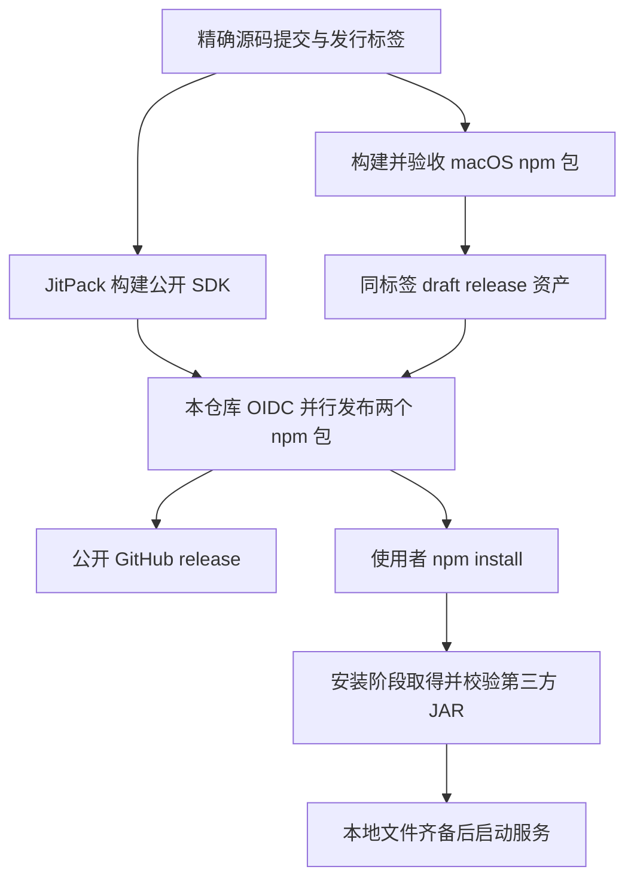

# 安装与发布

源码、skill、SDK 构建与 npm 发行共用本仓库。安装服务只需 npm；开发独立连接器时，Gradle 从 JitPack 获取 SDK；产品维护者在同一精确标签上准备 SDK 和 npm 产品。

## 使用者安装与启动

```sh
npm install --global @hanger-source/agentic-olap
agentic-olap start
```

需要 Node.js 20 或更高，当前平台为 macOS arm64。npm 安装执行以下工作：

1. 安装主包及精确同版的 macOS arm64 运行包。主包包含命令入口、SDK 文档、内置插件与下载清单；运行包包含 Go 程序、自有 Kotlin JAR 与 JRE。
2. 主包的 `postinstall` 调用已安装的 Go 程序，按 Gradle 解析并锁定的 URL、大小和 SHA-256，并行取得第三方 JVM JAR 与内置 H2、DuckDB 驱动。它们来自 Maven Central。
3. 校验每个文件后写入内容缓存及安装目录。缓存命中时复用已校验字节；下载或校验失败使 npm 安装失败。

安装完成时，运行文件已经齐备。`start` 只核验并使用本地文件，创建配置、访问令牌和持久目录，启动完整 MCP 服务；不再下载依赖，也不要求使用者安装 JDK、Gradle、Go 或执行另一条安装命令。

缓存、代理与配置方法见[产品安装说明](../project/cli/README.md)。升级仍使用 npm：停止服务、安装明确目标版本，再用原 `--home` 或 `--config` 启动。安装不会重启已有进程，也不会自动转换持久资产格式。

## 独立连接器取得 SDK

```sh
agentic-olap sdk
```

该命令只读取随包声明，返回 API、文档、`mavenRepository` 和 `artifacts` 中的精确坐标。插件工程配置：

```kotlin
repositories {
    mavenCentral()
    maven("https://jitpack.io") {
        content { includeGroup("com.github.hanger-source.agentic-olap") }
    }
}

dependencies {
    compileOnly("com.github.hanger-source.agentic-olap:connector-api:v0.11.0")
}
```

坐标以目标服务的实际 SDK 声明为准。SDK 的 JAR、POM 及本项目模块依赖从 JitPack 取得，第三方依赖从 Maven Central 取得。插件开发需要自己的 Kotlin／Gradle 工程；SDK 使用者无需配置下载令牌、查找 GitHub 资产或手工解压。共同合同、Kotlin runtime 和 Calcite 不打入插件 JAR，部署内容见[连接器 API](../project/modules/kernel/connector-api/README.md)。

JitPack 不参与服务启动，也不替代业务连接器。具体后端的访问协议、鉴权、原生类型与 SQL 映射仍由独立插件负责。

## 维护者构建与发布

`project/cli/package.json` 拥有产品版本。SDK 的 group 为 `com.github.hanger-source.agentic-olap`，版本与源码发行标签均为 `v` 加产品版本；npm 版本不带 `v`。连接器 API、存储格式、Query 格式与语义资产版本继续分别管理。

发行按以下顺序进行：

1. **准备精确源码。** 完成代码、文档和相称验证后提交，将该提交及匹配产品版本的 `vX.Y.Z` 标签推送到源码仓库。标签固定 SDK 和产品的同一源码起点。
2. **构建公开 SDK。** 在源码仓库手动运行 `构建 JitPack SDK`，选择同一标签。JitPack 使用根 `jitpack.yml` 指定的 JDK 21，在 `project/` 调用 `publishSdkToMavenLocal`。该任务只发布 SDK 模块及其模块依赖，不构建 Go、服务进程或 npm 包。工作流取得构件后确认入口 JAR、POM 可匿名读取。
3. **构建产品包。** 源码仓库的 `npm 平台运行包` 工作流编译 Kotlin 和 Go、生成完整研发发行目录、生成当前 macOS arm64 的 npm 运行包、主包及 `SHA256SUMS`，作为同一份 Actions 构件上传。第三方 JAR 从包中退出，由真实 Gradle 解析结果生成安装清单。现有安装试验从实际 tarball 安装并启动、查询、保存结果和重启读取。
4. **准备发行资产。** 在本仓库为该标签建立 draft release，上传同轮两份 npm tarball 和自动生成的 `SHA256SUMS`。skill 直接使用标签中的 `skills/agentic-olap`，不生成或同步另一份仓库。npm 版本和平台依赖只由 `project/cli/package.json` 声明。
5. **发布 npm 与 GitHub release。** 在本仓库手动运行 `发布 Agentic OLAP`，指定该 draft 的标签。工作流检出该标签，取得并核验资产，确认同版 SDK 入口可匿名下载，使用 GitHub OIDC 并行提交 npm 主包与 macOS arm64 运行包，成功后公开 GitHub release。npm 接受提交即记录结果，不轮询 registry。若部分包已经受理，按日志在 `submitted` 中明确填写包名，再继续剩余提交。

平台包构建与 SDK 构建可在同一源码提交上并行进行；公开 npm 产品前，SDK 和产品安装验收都应完成。源码、产品文档、skill 和发布脚本由同一标签固定。构建完成、源码 push、SDK 公开和 npm 发布各有实际结果，不以其中一项代替其他项。三个完整业务用法仍按需手动运行，不因本次发行而加入 push／PR 的重复业务执行。



### 外部发布配置

JitPack 直接读取本公开仓库的发行标签，使用免费公开构建，无需私有仓库授权、访问令牌或私有构建订阅。维护者和 SDK 使用者均可匿名请求公开构件。

两个 npm 包的可信发布者均应绑定 GitHub 用户 `hanger-source`、仓库 `agentic-olap` 和工作流文件 `release.yml`。工作流通过 OIDC 取得短期发布权限，不保存长期 npm 令牌。仓库改名后，维护者需同步 npm 上的可信发布配置。

本项目不向 Maven Central 发布 SDK，不需要 Sonatype 账号、命名空间或 GPG 发布签名。第三方 JAR 本来就在 Maven Central，npm 安装从其公开仓库取回锁定文件，无需我们重新上传。JitPack 的构建方法见[正式合同](https://docs.jitpack.io/building/)。

SDK 的本地构建命令为 `./project/gradlew -p project stageSdk`；输出 `project/build/sdk/maven` 供独立 Gradle 工程验证传递依赖。它不代表 JitPack 已远程构建或已匿名公开。
