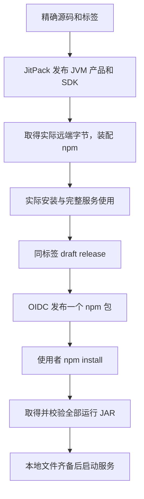

# 安装与发布

源码、skill、JVM 构建与 npm 发行共用本仓库。服务使用一个 npm 包安装；自有 JVM 产品构件和 SDK 由 JitPack 交付，第三方 JVM 依赖来自 Maven Central。

## 安装与启动

```sh
npm install --global @hanger-source/agentic-olap
agentic-olap start
```

需要 Node.js 20 或更高，支持 macOS arm64。npm 包携带 Go 程序、JRE、精确下载清单、SDK 文档、插件声明和许可。命令直接指向 Go 程序，没有平台子包或 JS 启动壳。

安装脚本调用随包 Go 程序，从 JitPack 取得同标签 Kotlin 运行构件和内置连接器，从 Maven Central 取得第三方 JVM 库与 H2、DuckDB 驱动。产品及依赖 JAR 均不打进 npm 归档。下载按锁定 URL、大小和 SHA-256 校验，备齐服务、脚本编译运行的 classpath 和插件组；相同内容可复用缓存。下载或校验失败使安装失败，不接受缺失依赖的安装结果。

安装完成即可启动。启动只核验和使用本地文件，不下载或解析依赖。无需安装 JDK、Gradle、Kotlin 编译器或 Go，也不需执行第二条安装命令。缓存、代理、配置和升级操作见[产品安装说明](../project/cli/README.md)。升级不会自动重启服务、改写业务配置或转换持久资产格式。

## 独立连接器 SDK

`agentic-olap sdk` 只读取随包声明，返回 API、文档、JitPack 仓库和精确 Maven 坐标。插件工程配置：

```kotlin
repositories {
    mavenCentral()
    maven("https://jitpack.io") {
        content { includeGroup("com.github.hanger-source.agentic-olap") }
    }
}
dependencies {
    compileOnly("com.github.hanger-source.agentic-olap:connector-api:v0.16.0")
}
```

新建或确需重构的插件采用目标宿主实际披露的精确 SDK 坐标。自有模块的 JAR 和 POM 来自 JitPack，第三方依赖来自 Maven Central。无需下载令牌、查找 GitHub 归档或手工解压。共同合同、Kotlin runtime 和 Calcite 不打入插件 JAR，具体部署边界见[连接器 API](../project/modules/kernel/connector-api/README.md)。业务后端的协议、鉴权、原生类型及 SQL 映射仍由独立插件负责。

独立插件的部署按实际变化处理：

- 产品版本或 SDK Maven 坐标变化本身不要求重构。原插件与目标宿主的连接器 API 相同，所用公共接口的二进制合同及 JVM、Kotlin、Calcite 要求满足时，可原样使用完整插件组。装载器核验 manifest、逐 JAR 摘要、组摘要、唯一 provider 及其完整身份，不比较产品发行号或 Maven 构建版本。API 字符串相同和装载成功不单独证明所有尚未调用的分支；升级需验证实际使用的编译和访问能力。
- 原插件字节、完整 `connectorRef` 和来源身份配置均未改变时，来源绑定不变。宿主产品版本与 SDK 坐标不参与 `sourceIdentityHash`，无需仅为产品升级重登记来源结构或修订依赖资产。
- 真正更换插件字节、provider 版本或来源身份参数时，使用真实生成的 manifest 与新精确引用，为目标绑定取得结构证据。通过 `read-asset-definition/read-definition-dependencies/read-definition-impact` 读取精确定义与影响，再用 `revise-physical-table` 及对应依赖定义的修订／采用入口显式组织新版本；`read-definition-revision-diff` 供核对差异，`activate/build-release` 明确激活、发布。已有版本与发布保留原引用，缺失精确绑定时失败；不存在自动传播目标绑定的迁移操作。完整调用见[连接说明](../skills/agentic-olap/references/connections.md#更换插件与显式采用)。

产品自身的运行 JAR、脚本环境和内置插件仍按同一发行标签装配。连接器 API 管理插件与宿主之间的正式合同；破坏该边界的接口、所需共享类型或运行要求时必须更新 API 身份，不能只更换产品版本后仍声称原合同成立。SDK 的其他公共定义不因共享一个 Maven 发行版本而自动取得连接器 SPI 的跨版保证。

## 维护者构建与发布

`project/cli/package.json` 拥有产品版本、命令入口及平台限制。自有 JVM 构件的 group 为 `com.github.hanger-source.agentic-olap`，版本为 `v` 加产品版本；npm 版本不带 `v`。连接器 API、DSL API、存储格式、Query 格式和语义资产版本分别管理。独立 `kotlin-repl` 与 OLAP 运行入口由同一产品装配，使用者不另装服务或包。正式作者使用 Kotlin 类型，内部 Protobuf schema 与显式转换器承载通信与持久字节，不要求业务代码维护协议消息。

一次语言会话固定产品构建、Kotlin 版本、DSL、classpath、默认 imports 与 JVM 目标，不在存活会话里替换 JAR。升级沿明确停止服务、安装并启动的现有入口进行；旧语言内存结束，持久业务资产按各自格式和授权继续读取，不承诺跨版本搬运 JVM 对象。

1. 完成代码、文档和相称验证后提交，推送精确发行标签 `vX.Y.Z`。源码、skill 和构建均采用该标签。
2. 手动运行 **构建 JitPack JVM 构件**，指定标签。JitPack 使用 JDK 21 执行 `publishProductToMavenLocal`，发布服务运行模块、内置连接器、SDK 及其模块依赖，不编译 Go 或打包 npm。测试和示例模块不发布。隔离连接器 JAR 使用 `plugin` classifier。
3. 手动运行 **构建 npm 产品包**，指定同一标签。装配读取 Gradle 的实际依赖关系，从 JitPack 取得自有运行 JAR，以远端实际字节生成 classpath、插件身份和下载清单。第三方依赖使用 Gradle 已解析的坐标与摘要。本地重编译字节不能代替远端构件。输出一份 npm tarball 和 `SHA256SUMS`，并通过实际安装、MCP 建设与发布、真实来源查询、结果保存和重启读取验收。
4. 为该标签建立 draft release，上传同轮 tarball 和 `SHA256SUMS`。skill 直接使用标签中的 `skills/agentic-olap`，不生成或同步另一份仓库。
5. 手动运行 **发布 Agentic OLAP**，指定 draft 标签。工作流核验实际归档、文件摘要和完整安装清单，通过 GitHub OIDC 发布一个 npm 产品包，成功后公开 GitHub release。npm 接受提交即记录结果，不轮询 registry。若 npm 已受理而公开 release 失败，直接修正 release 状态，不重复提交 npm。

JitPack 构件完成后才能装配 npm，不能预先猜测远端 JAR 摘要。源码 push、JVM 公开、安装验收和 npm 发布各有实际结果，不能相互替代。三个完整业务用法按需手动运行，不加入 push／PR 的重复业务执行。



## 外部发布配置

JitPack 直接读取公开仓库标签，使用免费公开构建，不需要私有订阅或访问令牌。`@hanger-source/agentic-olap` 的可信发布者绑定 GitHub 用户 `hanger-source`、仓库 `agentic-olap` 和工作流文件 `release.yml`，使用短期 OIDC 权限，不保存长期 npm 令牌。

自有 JVM 构件不向 Maven Central 发布，不需要 Sonatype 账号、命名空间或 GPG 签名。第三方构件直接使用其 Maven Central 地址，不重新上传。JitPack 构建约定见[官方说明](https://docs.jitpack.io/building/)。

`./project/gradlew -p project stageSdk` 将 SDK 装配到 `project/build/sdk/maven`，供独立插件工程验证传递依赖；本地构建不能代替远端发布。研发服务发行目录直接使用 Gradle 构件，npm 产品装配读取 JitPack 构件；它们是研发构建与公开交付的不同产物，均不在启动时下载依赖。
